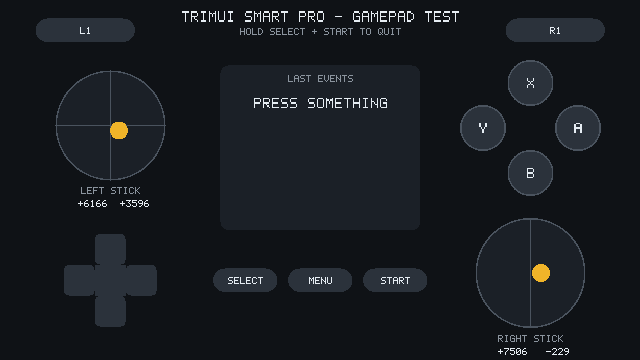

# padview

Shows the TrimUI Smart Pro gamepad state on the framebuffer (no X/Wayland needed): L1/R1,
both sticks with live dot and values, D-pad, ABXY, Select/Menu/Start, last six events.
Follows fbcon's rotation (`/sys/class/graphics/fbcon/rotate`). Hold SELECT+START for 1 s to quit.

    aarch64-linux-gnu-gcc -static -Os -Wall -o padview padview.c
    ./padview                 # run
    ./padview --shot out.ppm  # half-size landscape screenshot read back from /dev/fb0

